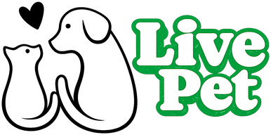

<div align="center">



# LivePet

**Cuidar nunca foi tão fácil.**
Plataforma integrada para gestão de saúde, identificação e conexões de animais de estimação.

<br>


<br>

[Ambientes em Produção](#-ambientes-em-produção-cloud---render) ·
[Funcionalidades](#funcionalidades) ·
[Começando](#começando) ·
[Estrutura](#estrutura-do-projeto) ·
[Contribuindo](#padrões-de-contribuição) ·
[Licença](#-licença)

</div>

<br>

---

## 🌐 Ambientes em Produção (Cloud - Render)

O ecossistema LivePet está publicado e operando na nuvem:

| Serviço | Descrição | Link de Acesso | Monitoramento / Status |
| :--- | :--- | :--- | :--- |
| **Front-end Web** | Interface do usuário em React / Vite (SPA) | [livepet-1.onrender.com](https://livepet-1.onrender.com/) | [](https://livepet-1.onrender.com/) |
| **Back-end API** | API RESTful em Python / FastAPI | [livepet.onrender.com](https://livepet.onrender.com/) | [](https://livepet.onrender.com/) |
| **Documentação Interativa (Swagger)** | Teste e documentação interativa de endpoints | [livepet.onrender.com/docs](https://livepet.onrender.com/docs) | [](https://livepet.onrender.com/docs) |
| **Healthcheck da API** | Verificação de integridade e conexão com banco Neon | [livepet.onrender.com/health](https://livepet.onrender.com/health) | [](https://livepet.onrender.com/health) |

---

## Sobre

O LivePet reúne em um só lugar o que hoje fica espalhado entre cadernetas de papel, fotos no celular e planilhas: a carteira de vacinas, o histórico veterinário, o pedigree, a identificação do animal e a rede de parceiros que atende o tutor.

Desenvolvido como Projeto Integrador, com foco em usabilidade e em um fluxo que o tutor consiga percorrer sem manual.

<br>

## Tecnologias

<table>
<tr><td><b>Interface</b></td><td>React 18 · JavaScript · Vite 5</td></tr>
<tr><td><b>Estilização</b></td><td>Tailwind CSS · shadcn/ui (Radix) · Lucide React</td></tr>
<tr><td><b>Roteamento</b></td><td>React Router DOM 6</td></tr>
<tr><td><b>Dados assíncronos</b></td><td>TanStack React Query 5</td></tr>
<tr><td><b>Backend API</b></td><td>FastAPI (Python) · SQLAlchemy · PostgreSQL (Neon) · JWT Auth</td></tr>
<tr><td><b>Cloud / Deploy</b></td><td>Render (Static Site para Front-end e Web Service para Back-end)</td></tr>
<tr><td><b>Formulários</b></td><td>React Hook Form · Zod</td></tr>
<tr><td><b>Testes</b></td><td>Pytest / Unittest (Backend) · Vitest (Frontend)</td></tr>
<tr><td><b>Documentos</b></td><td>jsPDF · qrcode.react · Recharts</td></tr>
</table>

> O projeto nasceu em TypeScript e foi migrado para JavaScript. Componentes novos gerados pelo shadcn/ui saem em `.jsx`, conforme `components.json`.

<br>

## Funcionalidades e Rotas do Front-end

| Rota Web | Módulo | O que faz |
| :--- | :--- | :--- |
| `/` | Institucional | Landing page com apresentação dos pilares e serviços da plataforma |
| `/login` | Autenticação | Login e cadastro de tutores via API FastAPI com emissão de token JWT |
| `/pets` | Meus Pets | Painel com os animais cadastrados, filtros dinâmicos por espécie e alertas de saúde |
| `/pets/novo` | Cadastro | Cadastro de novo pet conectado ao backend Neon com upload e compressão de foto |
| `/saude` | Vacinas | Carteira digital de vacinas — doses, reforços, pendências e comprovantes |
| `/historico-medico` | Prontuário | Histórico clínico, consultas, exames, evolução de peso e emissão de relatório PDF |
| `/vitrine-pet` | Marketplace | Vitrine de filhotes para adoção e cruza responsável, filtros e ciclo de vida de 30 dias |
| `/matchpet` | Conexões | Compatibilidade entre pets para cruza responsável e socialização |
| `/pedigree` | Genealogia | Árvore genealógica de 3 gerações, validação de certificados e solicitação de parentesco |
| `/cartao` | QR Code | Cartão animal digital, dados de emergência, contatos de cuidado e exportação |
| `/tasks` | Rotina | Agenda diária de cuidados e lembretes para alimentação, remédios e passeios |
| `/chat` | Comunicação | Mensagens internas, alertas de notificações e renovação de anúncios |
| `/perfil` | Conta Tutor | Gestão de dados pessoais, contatos e foto de perfil do tutor |
| `/parcerias` | Benefícios | Rede de parceiros credenciados (clínicas, petshops e farmácias) |
| `/clinica/entrar` | Auth Clínica | Portal de acesso exclusivo para clínicas veterinárias parceiras |
| `/clinica` | Dashboard Clínica | Painel de controle com atendimentos do dia, alertas e pacientes recentes |
| `/clinica/agenda` | Agenda Clínica | Gestão de atendimentos (novo atendimento, filtro por data, status e observações) |
| `/clinica/pacientes` | Prontuário Clínico | Lista de pacientes atendidos, histórico veterinário e atalho de novo agendamento |
| `/clinica/perfil` | Perfil da Clínica | Dados cadastrais, CRMV, equipe técnica, horários e serviços oferecidos |

<br>

## 🔌 Especificação da API REST (Back-end FastAPI)

A API do LivePet segue a arquitetura RESTful com autenticação Bearer JWT, validação estrita via Pydantic V2 e documentação interativa OpenAPI/Swagger.

### 1. Autenticação & Perfil de Tutores (`/api/v1/auth`)

| Método | Endpoint | Protegido | Descrição |
| :--- | :--- | :---: | :--- |
| `POST` | `/api/v1/auth/register` | Não | Cadastro de novo tutor (nome, e-mail, senha forte, telefone) |
| `POST` | `/api/v1/auth/login` | Não | Autenticação de tutor com emissão do Bearer Token JWT |
| `GET` | `/api/v1/auth/me` | Sim | Consulta dados do tutor autenticado |
| `PUT` | `/api/v1/auth/me` | Sim | Atualiza dados cadastrais, telefone, endereço e avatar do tutor |

### 2. Gestão de Pets, Vacinas & Prontuário (`/api/v1/pets`)

| Método | Endpoint | Protegido | Descrição |
| :--- | :--- | :---: | :--- |
| `GET` | `/api/v1/pets/especies` | Não | Lista espécies sincronizadas com o banco de dados |
| `GET` | `/api/v1/pets` | Sim | Lista todos os pets vinculados ao tutor autenticado |
| `POST` | `/api/v1/pets` | Sim | Cadastra novo pet com geração automática do token QR Code |
| `GET` | `/api/v1/pets/explore` | Não | Vitrine de animais públicos para adoção/exploração |
| `GET` | `/api/v1/pets/{pet_id}` | Sim | Obtém detalhes completos de um pet específico |
| `PUT` | `/api/v1/pets/{pet_id}` | Sim | Atualiza dados cadastrais do pet (porte, peso, cor, foto) |
| `DELETE` | `/api/v1/pets/{pet_id}` | Sim | Remove pet e seus registros associados em cascata |
| `GET` | `/api/v1/pets/{pet_id}/vaccines` | Sim | Lista carteira de vacinas do pet |
| `POST` | `/api/v1/pets/{pet_id}/vaccines` | Sim | Registra nova dose/vacina com data e lote |
| `DELETE` | `/api/v1/pets/{pet_id}/vaccines/{id}` | Sim | Remove registro de vacina |
| `GET` | `/api/v1/pets/{pet_id}/medical-records` | Sim | Lista prontuário clínico e histórico de pesagens |
| `POST` | `/api/v1/pets/{pet_id}/medical-records` | Sim | Adiciona registro clínico, diagnóstico ou aferição de peso |
| `DELETE` | `/api/v1/pets/{pet_id}/medical-records/{id}` | Sim | Exclui registro médico |
| `GET` | `/api/v1/pets/{pet_id}/care-contacts` | Sim | Lista contatos de emergência e cuidadores autorizados |
| `POST` | `/api/v1/pets/{pet_id}/care-contacts` | Sim | Cadastra contato de confiança para o pet |
| `DELETE` | `/api/v1/pets/{pet_id}/care-contacts/{id}` | Sim | Remove contato de confiança |
| `GET` | `/api/v1/public/pet/{token_publico}` | Não | **Coleira QR Code**: Rota pública de emergência médica e contato |

### 3. Portal & Atendimentos da Clínica Veterinária (`/api/clinicas`)

| Método | Endpoint | Protegido | Descrição |
| :--- | :--- | :---: | :--- |
| `POST` | `/api/clinicas/register` | Não | Cadastro de clínica veterinária parceira (CRMV, CNPJ, contatos) |
| `POST` | `/api/clinicas/login` | Não | Login exclusivo de clínica emitindo token JWT com claim `role: "clinic"` |
| `GET` | `/api/clinicas/me` | Sim (Clínica) | Retorna os dados da clínica veterinária autenticada |
| `PUT` | `/api/clinicas/perfil` | Sim (Clínica) | Atualiza informações cadastrais, equipe, CRMV e descrição |
| `GET` | `/api/clinicas/especies` | Não | Espécies sincronizadas do banco de dados (Cão, Gato, Ave, etc.) |
| `GET` | `/api/clinicas/atendimentos` | Sim (Clínica) | Lista atendimentos com filtros por data (`YYYY-MM-DD`) e status |
| `POST` | `/api/clinicas/atendimentos` | Sim (Clínica) | Agenda novo atendimento com pet, tutor, serviço, data, hora e queixa |
| `PATCH` | `/api/clinicas/atendimentos/{id}/status` | Sim (Clínica) | Atualiza status (`Aguardando`, `Em atendimento`, `Concluído`, `Cancelado`) |
| `DELETE` | `/api/clinicas/atendimentos/{id}` | Sim (Clínica) | Exclui/cancela atendimento agendado |

### 4. Genealogia & Linhagens de Pedigree (`/api/v1/lineages`)

| Método | Endpoint | Protegido | Descrição |
| :--- | :--- | :---: | :--- |
| `GET` | `/api/v1/lineages/tree/{pet_id}` | Não | Monta árvore genealógica completa de até 3 gerações |
| `POST` | `/api/v1/lineages/requests` | Sim | Solicita validação de vínculo parental (pai/mãe) |
| `GET` | `/api/v1/lineages/requests/pending`| Sim | Lista solicitações de parentesco pendentes de validação |
| `POST` | `/api/v1/lineages/requests/{id}/approve` | Sim | Aprova vínculo parental na árvore genealógica |
| `POST` | `/api/v1/lineages/requests/{id}/reject` | Sim | Rejeita vínculo parental |

### 5. Marketplace de Filhotes (`/api/v1/marketplace`)

| Método | Endpoint | Protegido | Descrição |
| :--- | :--- | :---: | :--- |
| `GET` | `/api/v1/marketplace/listings` | Não | Lista filhotes disponíveis com filtros por espécie, porte e preço |
| `GET` | `/api/v1/marketplace/my-listings` | Sim | Lista anúncios publicados pelo usuário autenticado |
| `POST` | `/api/v1/marketplace/listings` | Sim | Publica novo anúncio com fotos e dados da ninhada |
| `DELETE` | `/api/v1/marketplace/listings/{id}` | Sim | Encerra e remove publicação de anúncio |
| `POST` | `/api/v1/marketplace/listings/{id}/confirm` | Sim | Confirmação do ciclo de 30 dias (`renovar` ou `encerrar`) |

### 6. Monitoramento & Saúde (`/health`)

| Método | Endpoint | Protegido | Descrição |
| :--- | :--- | :---: | :--- |
| `GET` | `/health` | Não | Verifica disponibilidade da API e conectividade com o banco Neon |

> 💡 **Nota sobre prefixos**: Todas as rotas acima estão disponíveis com o prefixo padrão `/api/v1/` e também mapeadas diretamente na raiz (ex: `/pets`, `/auth/login`, `/clinicas/*`).

<br>

<br>

## Começando

### Pré-requisitos

- Node.js 18 ou superior
- Python 3.10+ (para executar o backend localmente)
- PostgreSQL ou SQLite local

### 1. Clonar o repositório

```bash
git clone https://github.com/LIVEPET/LIVEPET.git
cd LIVEPET
```

### 2. Front-end (React / Vite)

Instale as dependências e configure o ambiente:

```bash
npm install
cp .env.example .env
```

Preencha a URL da API FastAPI no `.env` (local ou em nuvem):

```env
VITE_API_URL=http://localhost:8000
```

Inicie o servidor de desenvolvimento:

```bash
npm run dev
```

Disponível em **http://localhost:8080**

### 3. Back-end API (FastAPI) — Opcional para dev local

Caso queira executar a API localmente (consulte detalhes em [backend/README.md](backend/README.md)):

```bash
cd backend
python -m venv venv

# Windows (PowerShell):
.\venv\Scripts\activate

# Linux / Mac:
source venv/bin/activate

pip install -r requirements.txt
cp .env.example .env
uvicorn app.main:app --reload
```

A API local estará disponível em **http://localhost:8000** (Swagger em **/docs**).

<details>
<summary><b>Build de produção</b></summary>

<br>

```bash
npm run build     # gera a pasta dist/
npm run preview   # serve o resultado localmente
```

Abrir o `index.html` diretamente no navegador não funciona: ele referencia o código-fonte processado pelo Vite, e módulos ES são bloqueados no protocolo `file://`. Use sempre `dev` ou `preview`.

</details>

<details>
<summary><b>Todos os scripts</b></summary>

<br>

| Comando | Função |
| :--- | :--- |
| `npm run dev` | Servidor de desenvolvimento com recarregamento automático |
| `npm run build` | Build otimizado para produção |
| `npm run build:dev` | Build em modo de desenvolvimento |
| `npm run preview` | Serve localmente o resultado do build |
| `npm run lint` | Análise estática com ESLint |
| `npm run test` | Executa a suíte de testes uma vez |
| `npm run test:watch` | Executa os testes em modo de monitoramento |

</details>

<br>

## Estrutura do projeto

```text
livepet/
├── backend/                  API RESTful em Python / FastAPI e banco Neon
│   ├── app/                  Modelos, schemas, rotas e dependências
│   ├── sql/                  Scripts e esquemas DDL do banco de dados
│   ├── tests/                Testes automatizados com Pytest
│   └── manage_db.py          Gerenciador de migrações e seed do banco
├── docs/                     Roadmap, comunicados e levantamento de requisitos
├── public/                   Ícones, manifesto e arquivos estáticos públicos
├── src/
│   ├── assets/               Imagens e recursos estáticos
│   ├── components/           Componentes reutilizáveis
│   │   └── ui/               Componentes base do shadcn/ui
│   ├── data/                 Dados mock para demonstração e previews
│   ├── hooks/                Hooks customizados
│   ├── lib/                  Utilitários e regras de negócio
│   ├── pages/                Páginas da aplicação
│   │   └── Clinic/           Portal e telas da clínica veterinária
│   ├── services/             Cliente HTTP (api.js) integrado à FastAPI
│   ├── test/                 Configuração da suíte de testes
│   ├── App.jsx               Roteador central e provedores de contexto
│   ├── main.jsx              Ponto de entrada do React
│   └── index.css             Estilos globais e design tokens
├── render.yaml               Especificação de deploy no Render (Front e Back)
├── eslint.config.js
├── tailwind.config.js
├── vite.config.js
├── vitest.config.js
└── package.json
```

<br>

## Testes

Vitest com Testing Library em ambiente jsdom. Os arquivos ficam ao lado do código que testam, no formato `NomeDoArquivo.test.jsx`.

```bash
npm run test
```

<br>

## Padrões de contribuição

<table>
<tr>
<td width="50%" valign="top">

**Branches**

`tipo/numero-descricao`

Exemplo: `feat/8-carteira-vacinas`

Prefixos: `feat`, `fix`, `chore`, `docs`, `refactor`, `test`

</td>
<td width="50%" valign="top">

**Commits**

Conventional Commits, com a issue referenciada no corpo:

```
feat(saude): adiciona carteira de vacinas

Closes #8
```

</td>
</tr>
</table>

### Antes de abrir o pull request

```bash
npm run test && npm run lint && npm run build
```

A descrição deve trazer o resumo da alteração, o roteiro de teste para quem revisa e as observações relevantes. Pull requests acima de 400 linhas devem ser divididos, e ninguém aprova o próprio.

### Definição de pronto

- [ ] Testes, lint e build passando
- [ ] Interface verificada em 375 pixels de largura
- [ ] Estados de carregamento, lista vazia e erro implementados
- [ ] Migrações, quando houver, testadas em banco limpo

<br>

## Estado atual

Os principais fluxos operacionais estão integrados à API FastAPI e ao banco PostgreSQL (Neon): autenticação com JWT, cadastro e listagem de pets, carteira de vacinas, prontuários médicos, árvore de linhagens/pedigree com requisições de parentesco, consulta pública de emergência via QR Code, marketplace de filhotes e portal exclusivo de clínicas veterinárias parceiras com gestão de agenda, atendimentos e sincronização de espécies.

Acompanhado pela equipe:

| Item | Situação |
| :--- | :--- |
| Autenticação JWT e perfil do tutor | Concluído |
| CRUD de pets conectado ao banco | Concluído |
| Proteção de rotas autenticadas (Tutor e Clínica) | Concluído |
| Integração das listagens centrais (pets, vacinas, marketplace) | Concluído |
| Sistema de linhagens e aprovação de parentesco | Concluído |
| Portal da Clínica: autenticação com role `clinic` e perfil | Concluído |
| Gestão de Atendimentos Clínicos (agenda, observações e persistência) | Concluído |
| Sincronização de catálogo de espécies com o banco de dados | Concluído |
| Divisão do bundle por rota (code splitting) | Planejado |
| Ampliação da cobertura de testes (63 testes automatizados no backend) | Contínuo |

<br>

---

## 📄 Licença

Este projeto é um software proprietário com **Todos os direitos reservados** à equipe **LIVEPET**. 

O código-fonte, arquitetura, design e ativos visuais pertencem exclusivamente aos autores. Não é permitida a cópia, redistribuição, hospedagem como serviço (SaaS), engenharia reversa ou exploração comercial deste projeto, no todo ou em parte, sem autorização prévia por escrito. 

Para mais detalhes, consulte o arquivo [LICENSE](LICENSE).

<br>

<div align="center">

Projeto desenvolvido no âmbito acadêmico com plano de continuidade e monetização.

</div>
